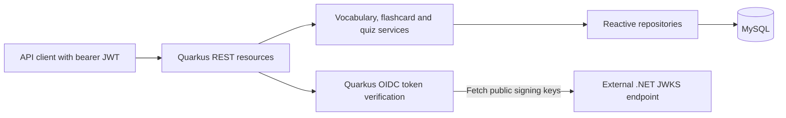

# Japanese Learning Backend

Quarkus backend for the Japanese Learning application. This repository builds one application (`com.japaneselearning:backend`), containing vocabulary management, flashcard queries, and Kanji Context Quiz features. These are Java packages within one deployment, not independently runnable Maven modules.

In the wider system, Angular provides the frontend and .NET owns authentication and user management. This application consumes the authentication service's public JWKS and verifies bearer tokens locally. Angular and .NET source code, API Gateway routing, and full-system orchestration are outside this repository.

## Technology stack

| Component | Implementation |
| --- | --- |
| Java | Java 17 compilation target; root container uses JDK/runtime 17 |
| Quarkus | 3.38.2, managed by the Quarkus BOM |
| Maven | Wrapper distribution 3.9.16; wrapper 3.3.4 with distribution checksum |
| HTTP and JSON | Quarkus REST, Jackson, Jakarta Validation |
| Dependency injection | Quarkus ArC/CDI |
| Persistence | Hibernate Reactive Panache, Mutiny, reactive MySQL client |
| Database | MySQL 8-compatible schema; quiz migrations use `utf8mb4_0900_bin` and CHECK constraints |
| Migrations | Versioned Flyway SQL; executed externally, with no Flyway dependency/plugin in this application |
| Security | Quarkus OIDC bearer-token resource server, RS256 JWT verification |
| API and operations | SmallRye OpenAPI, Swagger UI, SmallRye Health, Micrometer Prometheus |
| Tests | JUnit Jupiter via `quarkus-junit`, REST Assured, jose4j token fixtures; Surefire/Failsafe 3.5.6 |
| Containers | Root multi-stage Dockerfile with pinned Java 17 build/runtime images |

Library versions other than explicitly pinned Maven plugins are managed by the Quarkus BOM. The repository does not pin a MySQL server or external Flyway version.

## Architecture

| Feature area | Responsibility |
| --- | --- |
| `vocabulary` | JLPT levels, lesson management, atomic vocabulary imports, and Admin editing of vocabulary and related content |
| `flashcard` | Vocabulary cards, personal SRS/practice sessions, bookmarks, due queues and statistics |
| `quiz` | Admin question authoring/import/publication; player sessions, answers, completion, history, and progress |
| `common` | Response envelopes, centralized exception handling, configuration validation, tracing, health filtering, metrics, and logging |

Resources handle HTTP and validation, services orchestrate business rules, and repositories perform reactive persistence. Service methods use `Uni` and reactive session/transaction boundaries. DTOs and service assemblers construct API views; there is no separate mapper package or mapping framework. Imports move file parsing off the event loop.

All feature areas share the configured MySQL datasource. Flashcards read vocabulary entities; quizzes can reference vocabulary/examples and store session snapshots and user progress. User ownership comes from the JWT subject, without a local authentication service or per-request user-service lookup.



### API Gateway boundary

No Gateway application, proxy resource, routing table, or downstream forwarding client is implemented here. The routes below belong directly to this backend. Gateway URLs, path rewriting, Angular proxy/CORS setup, TLS termination, and Gateway authentication behavior must be obtained from the owning repository. No application CORS configuration is supplied here.

## Prerequisites

- JDK 17 with `JAVA_HOME` set for local Maven execution. A separate Maven installation is unnecessary when using the wrapper.
- Network access to retrieve the pinned Maven distribution and Maven dependencies on first use.
- A MySQL 8 server supporting the migration syntax and an externally managed Flyway runner for real application/database testing.
- A reachable .NET public JWKS endpoint and valid User/Admin tokens for normal API use. Default automated tests supply their own JWKS server.
- Docker only for container builds/runs or infrastructure managed outside this repository. The root image build does not require a host JDK.

## Getting started

1. Open the Quarkus checkout containing this README and `pom.xml`. If accessed through a parent checkout, enter its `quarkus` directory. Repository clone URLs and submodule initialization instructions are not defined here.
2. Start your MySQL instance, create a UTF-8 application database and application account, then apply all migrations as described under [Database and persistence](#database-and-persistence).
3. Start the external authentication service and confirm its configured public JWKS URL is reachable from the machine/container running Quarkus.
4. Create an untracked `.env` in this directory, replacing the placeholders with your local configuration:

   ```dotenv
   DB_USERNAME=<application-database-user>
   DB_PASSWORD=<local-database-password>
   DB_REACTIVE_URL=mysql://localhost:3306/japanese_learning
   AUTH_SERVER_URL=http://localhost:5116
   AUTH_JWT_ISSUER=JapaneseLearning.User
   AUTH_JWT_AUDIENCE=JapaneseLearning
   ```

5. Start all implemented Quarkus features together:

   ```sh
   ./mvnw quarkus:dev
   ```

   On Windows PowerShell, use `.\mvnw.cmd quarkus:dev`. Maven resolves dependencies as part of the command; no separate dependency-install step is required.

6. Open `http://localhost:8080/q/swagger-ui`, authorize with a raw access token, and explore the API. Use `http://localhost:8080/q/health/ready` to check readiness.

There is no Compose file or command in this checkout that starts Angular, .NET, MySQL, migrations, and Quarkus together. Supply those external services before starting this application.

## Environment configuration

Runtime defaults live in [application.properties](src/main/resources/application.properties). Use environment variables or a local `.env`; keep credentials out of source control. The application validates required settings at startup and reports the offending property name without echoing its value.

| Variable | Default / requirement |
| --- | --- |
| `DB_USERNAME` | Required, nonblank MySQL username |
| `DB_PASSWORD` | Required, nonblank password, supplied separately from the URL |
| `DB_REACTIVE_URL` | Required; `mysql://host:3306/database_name` |
| `AUTH_SERVER_URL` | `http://localhost:5116` |
| `AUTH_JWKS_URL` | `${AUTH_SERVER_URL}/.well-known/jwks.json`; override with a full HTTP(S) URL |
| `AUTH_JWT_ISSUER` | `JapaneseLearning.User`; must match the token issuer |
| `AUTH_JWT_AUDIENCE` | `JapaneseLearning`; must match the token audience |
| `VOCABULARY_IMPORT_MAX_BATCH_SIZE` | `500` items per vocabulary batch |
| `APP_LOG_LEVEL` | `INFO` for application packages |
| `APP_LOG_FILE_ENABLED` | `true`; disabled by default in the test profile |
| `APP_LOG_DIR` | `logs`; root image overrides to `/deployments/data/logs` |
| `APP_LOG_FILE` | `application.log` |
| `APP_LOG_RETENTION_DAYS` | `30`, must be positive |

URL validation rejects embedded credentials, query strings, and fragments. Database URLs must use `mysql`, not `jdbc:mysql`, with a simple database-name path. Auth/JWKS URLs must be absolute HTTP(S) URLs. Even with an explicit JWKS URL, the auth-server setting must remain valid.

Additional properties declared in code are `quiz.import.max-file-bytes` (default `1048576`) and `quiz.import.max-items` (default `100`). They bound quiz file imports; see the [quiz import contract](docs/kanji-context-quiz-import.md).

Development mode uses the standard `dev` profile. Packaged runs use `prod`; there are no separate development/production property files. Tests add [test configuration](src/test/resources/application.properties), disable datasource Dev Services, start Hibernate offline, and use database doubles unless an explicit MySQL test profile is enabled. OIDC Dev Services are disabled for all profiles.

The current configuration sets `quarkus.swagger-ui.always-include=true`, including Swagger UI in packaged builds. It also disables Hibernate schema generation. Deployment owners should account for the exposed documentation and operational routes.

## Project structure

```text
.
|-- pom.xml                         # Single application build
|-- mvnw / mvnw.cmd                 # Unix / Windows Maven launchers
|-- .mvn/wrapper/                   # Pinned Maven distribution
|-- Dockerfile                     # Supported source-to-runtime image build
|-- docs/                          # Vocabulary editing and quiz contracts
|-- src/main/java/com/japaneselearning/
|   |-- common/                    # config, exception/handler, response,
|   |                              # resource, web, health, metrics, logging
|   |-- flashcard/                 # resource, service, repository, dto
|   |-- vocabulary/                # resource, service, repository, entity,
|   |                              # dto, importer, logging, admin
|   `-- quiz/                      # admin/player resources, services and DTOs;
|                                  # domain, entity, repository, service
|-- src/main/resources/
|   |-- application.properties
|   |-- META-INF/openapi.yaml      # Static contract merged with annotations
|   |-- META-INF/services/         # Configuration interceptor registration
|   |-- db/migration/              # Flyway V1-V8
|   `-- data/vocabulary/n5.json    # Vocabulary import data, not auto-seeded
|-- src/main/docker/               # Additional packaging templates
`-- src/test/                      # Unit, HTTP/security and opt-in MySQL tests
```

Security enforcement primarily uses configuration and resource annotations; there is no production `security` package. The test `security` package contains JWT/JWKS fixtures and HTTP/integration coverage.

## Authentication and authorization

The .NET service owns login, user accounts, and token issuance. Quarkus only requires its public signing keys. Configure the issuer/audience and JWKS URL to match that service; do not provide private signing keys or client secrets to this backend.

**Authentication:** OIDC runs in bearer-token service mode with discovery and JWT/opaque-token introspection disabled. Verification accepts RS256, requires a subject and expiration, validates issuer/audience, and rejects expired tokens and future `nbf` values with zero clock grace. `iat` is not required. The principal is `sub`. JWKS keys are cached; cached-key verification does not require a network call for every request. Key refresh still requires a reachable JWKS endpoint.

**Authorization:** the default application REST policy allows `User` or `Admin`. Roles come from the case-sensitive `role` claim. Explicit Admin annotations protect vocabulary writes, lesson writes, and quiz administration. Player quiz operations accept either application role and scope session/history/progress access to the authenticated subject.

Missing/invalid tokens produce 401; a valid identity without the required role produces 403. Health and API documentation routes are outside the default application REST role policy. Supplying an invalid bearer token to a public route can still trigger proactive authentication failure.

The `OidcProvider` logger is deliberately restricted to ERROR because verification warnings can contain rejected tokens. Keep service clocks synchronized and avoid enabling token-bearing diagnostic logs.

## Database and persistence

One reactive MySQL datasource supports vocabulary, lessons, flashcards, and quizzes. Hibernate's schema-management strategy is `none`: starting the application does not create or migrate tables.

Initialize a database with the external Flyway runner:

1. Create the chosen application database and separate runtime/migration credentials through your infrastructure setup.
2. Configure the runner's MySQL JDBC connection and migration location to this checkout's `src/main/resources/db/migration` directory.
3. Apply migrations in version order, currently V1 through V11, and confirm Flyway validation succeeds before starting Quarkus.
4. Point `DB_REACTIVE_URL` at the same database using the reactive `mysql://` URL format.

V1-V5 define vocabulary/master data and lessons; V6-V8 add quiz persistence, Admin identity fields, and classification snapshots. V9 adds personal flashcard learning persistence; V10 adds session abandonment and V11 indexes session lists. V2 seeds JLPT levels and parts of speech. Migrations do not populate lessons or import `n5.json`: create lessons through the Admin lesson APIs before importing vocabulary that references them.

Use MySQL with support for `utf8mb4_0900_bin` and enforced CHECK constraints; compatibility with MariaDB or older MySQL versions is not established. The Flyway runner/version and infrastructure launch command are not included here, so use the owning environment's migration procedure. Never edit an applied migration; add a new versioned SQL file.

Vocabulary JSON-body and multipart imports share one reactive transaction, with a default 500-item limit. Existing normalized words must retain matching level/lesson assignments; only new examples are appended, while existing core metadata remains unchanged. Use the Admin editing APIs for changes. The `updated` result counts existing vocabulary processed, even if its examples were already present. Concurrent example additions are not protected by a database uniqueness constraint and can race.

## API documentation

With the default local port:

| Endpoint | Purpose |
| --- | --- |
| `http://localhost:8080/q/openapi` | Generated OpenAPI document |
| `http://localhost:8080/q/swagger-ui` | Interactive requests; paste the raw JWT into Authorize |
| `http://localhost:8080/q/health` | Aggregate health |
| `http://localhost:8080/q/health/live` | Liveness |
| `http://localhost:8080/q/health/ready` | Readiness, including datasource health |
| `http://localhost:8080/q/metrics` | Prometheus metrics |

SmallRye OpenAPI combines [the static document](src/main/resources/META-INF/openapi.yaml) with resource annotations. Vocabulary Admin resources are excluded from annotation scanning because their contracts are defined statically. A global `bearerAuth` requirement describes application authentication; runtime role checks remain authoritative.

| API group | Base route | Access |
| --- | --- | --- |
| Flashcard list/detail | `/api/v1/flashcards` | User or Admin |
| JLPT catalogue | `/api/v1/jlpt-levels` | User or Admin |
| Lesson lookup/management | `/api/v1/lessons` | Reads: User/Admin; writes: Admin |
| Vocabulary JSON/file imports | `/api/vocabularies`, `/api/vocabularies/import` | Admin |
| Vocabulary editing and relationships | `/api/v1/admin/vocabularies/{vocabularyId}` | Admin |
| Quiz question authoring/import/publication | `/api/v1/admin/kanji-quiz/questions` | Admin |
| Quiz configuration, sessions, answers, history, progress | `/api/v1/kanji-quiz` | User or Admin, subject-scoped |

For example, `GET /api/v1/flashcards?level=N5&page=0&size=20` lists cards; multipart vocabulary imports use a `file` part. Preserve the existing unversioned vocabulary import path when integrating clients.

Business responses use `ApiResponse` with `success`, `data` or `error`, and metadata including timestamp, trace ID, and correlation ID. Null fields are generally omitted. Clients may supply `X-Trace-Id` and `X-Correlation-Id`; centralized handlers normalize error responses. Infrastructure routes have their own formats.

Detailed feature contracts:

- [Flashcard learning, practice, SRS, bookmarks and statistics](docs/flashcard-learning.md)
- [Admin vocabulary editing](docs/admin-vocabulary-edit.md)
- [Quiz administration](docs/kanji-context-quiz-admin.md) and [file import](docs/kanji-context-quiz-import.md)
- [Quiz gameplay](docs/kanji-context-quiz-game.md), [history](docs/kanji-context-quiz-history.md), and [progress](docs/kanji-context-quiz-progress.md)

## Available commands

Run from this repository root. Replace `./mvnw` with `.\mvnw.cmd` in PowerShell. There are no module-specific Maven commands.

| Task | Command |
| --- | --- |
| Development mode | `./mvnw quarkus:dev` |
| Compile | `./mvnw compile` |
| Default tests | `./mvnw test` |
| Focused tests | `./mvnw test "-Dtest=JwtSecurityTest,OpenApiSecurityTest,FlashcardResourceTest"` |
| Full Maven verification lifecycle | `./mvnw verify "-Dquarkus.http.test-port=0"` |
| Package with default tests | `./mvnw package` |
| Package without executing tests | `./mvnw package -DskipTests` |
| Run packaged fast-jar | `java -jar target/quarkus-app/quarkus-run.jar` |
| Build root container image | `docker build -t japanese-learning-backend:local .` |

These commands follow the checked-in build configuration; they are not a record of tests or builds executed during documentation maintenance.

## Testing

The default suite contains plain JUnit tests and `@QuarkusTest` HTTP tests using REST Assured. Tests cover business rules, response contracts, JWT roles/claims, OpenAPI, configuration, logging, metrics, and health. Service/repository alternatives and offline Hibernate startup avoid a live database for the default suite. `JwksTestResource` starts an ephemeral loopback HTTP server and generates RSA keys in memory, so a running .NET service is unnecessary.

Real-database tests are opt-in and exercise persistence, rollback, concurrency, Admin editing, and quiz lifecycle behavior. Provision a **disposable** database named exactly `vocabulary_import_test`, apply all current migrations through V11, and provide its test root password. The test profile hardcodes username `root` and rejects URLs not ending in `/vocabulary_import_test`. Tests write fixtures and may modify/delete data.

```powershell
.\mvnw.cmd verify "-Dquarkus.http.test-port=0" "-Dvocabulary.mysql.tests=true" `
  "-Dvocabulary.mysql.url=mysql://127.0.0.1:3306/vocabulary_import_test" `
  "-Dvocabulary.mysql.password=<test-root-password>"
```

Without `vocabulary.mysql.tests=true`, database tests are skipped. They are named `*Test` and run through Surefire; `-DskipITs=false` alone does not enable them. Failsafe is configured, with `skipITs=true` by default, but no `@QuarkusIntegrationTest` packaged-application tests are present. No coverage-reporting, formatter, or static-analysis plugin is configured.

## Build and deployment

The default package is a Quarkus fast-jar. Deploy the complete `target/quarkus-app/` directory, not just `quarkus-run.jar`, and supply the same runtime configuration as for development.

The root Dockerfile builds from source with the pinned Maven Wrapper and Java 17, skips tests during packaging, then copies only the fast-jar application into the UBI 9 OpenJDK 17 runtime. It runs as UID 185 and listens on `0.0.0.0:8080`. `.dockerignore` excludes local credentials, key material, tests, and build output.

After building, prepare an ignored `.env.docker` containing the variables documented above. Database and Auth hosts must be reachable **from the container**; `localhost` inside it does not refer to the host or another service. On an existing shared network, for example `japanese-learning`, run:

```sh
docker run --rm --name japanese-learning-backend --network japanese-learning --env-file .env.docker --mount type=volume,source=backend_logs,target=/deployments/data/logs -p 8080:8080 japanese-learning-backend:local
```

Replace the network name with the actual infrastructure network. Start MySQL, complete migrations, and make JWKS available before starting the backend. This container does not run migrations or provision infrastructure. No deployment pipeline or complete-stack launcher is defined in this checkout.

The `native` Maven profile enables native compilation (`./mvnw package -Dnative`), requiring a suitable GraalVM/native toolchain or a separately configured container build. No native toolchain version is pinned. Additional Dockerfiles in `src/main/docker` expect prebuilt artifacts under `target/`; the current root `.dockerignore` excludes that directory, so their embedded build commands are not usable unchanged. JVM templates there also use Java 21. Use the root Dockerfile for the documented Java 17 workflow.

### Operational behavior

Health responses retain overall status and check names/statuses while omitting datasource exception details. UP returns 200 and DOWN returns 503. Liveness indicates process health; readiness includes database availability. There is no custom continuous JWKS health check, so readiness is not an end-to-end Auth availability check. Gateway exposure of `/q` endpoints cannot be established here.

Console and file logging are asynchronous with discard-on-overflow queues. Files rotate daily; a background worker checks expired daily archives at startup and hourly, retaining 30 days by default without deleting the active file. There is no total disk-size cap. Use a separate writable log directory/volume for each instance and monitor capacity. Docker's log volume must be writable by UID 185; console retention is managed separately. These logs are diagnostics, not a durable audit trail.

## Troubleshooting

| Symptom | Check |
| --- | --- |
| `Invalid required configuration` at startup | Set all DB values; use a `mysql://host/database` URL with credentials supplied separately. Auth/JWKS must be absolute HTTP(S) URLs without credentials, query, or fragment. |
| Missing tables or failed database operations | Apply V1-V11 externally to the same database. Hibernate does not generate the schema. |
| Migration rejects collation or constraints | Confirm MySQL supports the MySQL 8 collation and CHECK syntax; do not substitute MariaDB without compatibility validation. |
| Import rejects a lesson assignment | Create the referenced lesson first; existing vocabulary must retain its level/lesson assignment set during import. |
| 401 from application APIs | Check token expiration, RS256 signature/key ID, issuer, audience, subject, service clocks, and JWKS reachability. |
| 403 from a write endpoint | Use an Admin token with the case-sensitive `role` claim; a User token cannot perform Admin operations. |
| Container cannot reach DB/Auth | Use hosts on the shared network or the environment's host-access address, not container-local `localhost`. |
| Tests conflict with another HTTP service | Add `"-Dquarkus.http.test-port=0"` to use an ephemeral test port. |
| MySQL tests are skipped or reject the URL | Set the opt-in property and use the dedicated `vocabulary_import_test` database with all migrations applied. |
| Alternate Dockerfile cannot copy `target/` | Use the root Dockerfile; the current build context excludes prebuilt output. |
| File logging fails or storage grows | Check UID 185 volume permissions and retention settings; daily retention does not impose a disk quota. |

## External setup information still required

The following cannot be derived from this checkout: clone/submodule URLs, the infrastructure startup command, exact MySQL/Flyway deployment versions, .NET login/startup and key-provisioning procedures, Angular API/proxy settings, Gateway routes/security, and production network/TLS configuration. Obtain these from their owning repositories before a full-system deployment. The local token contract and simulated security tests do not replace integration testing with real .NET-issued tokens.
